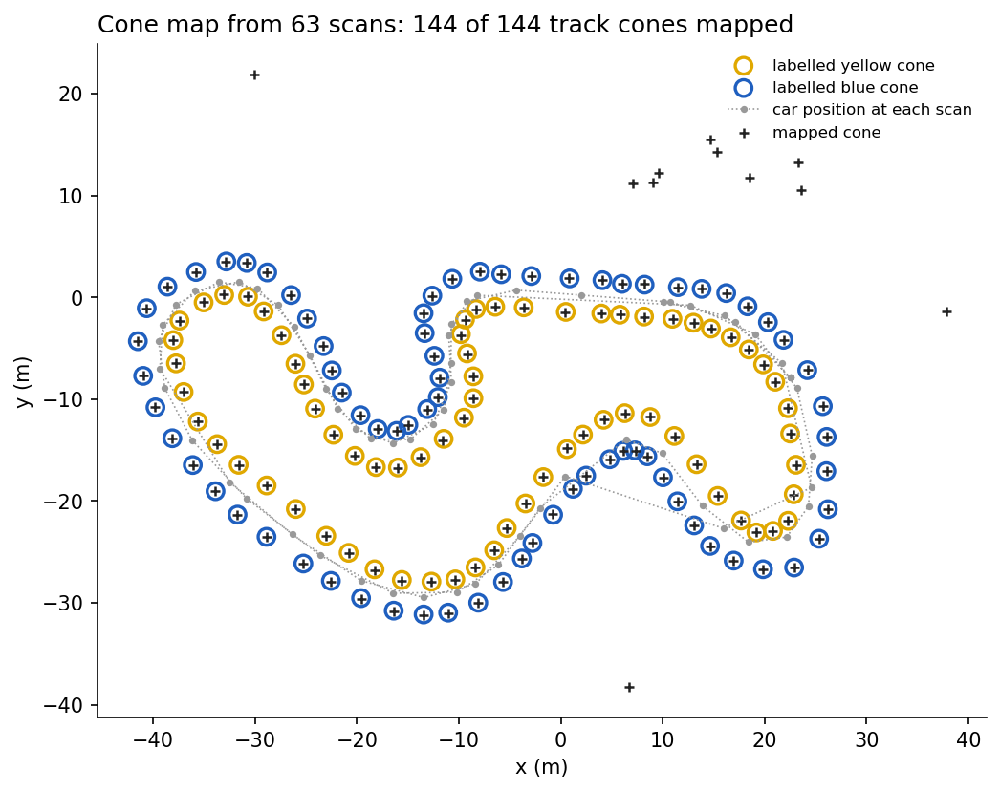
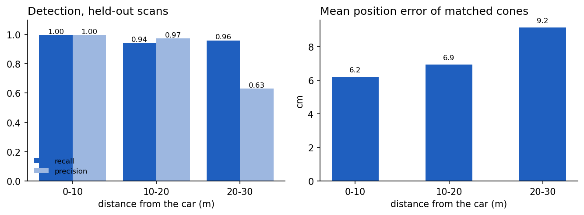
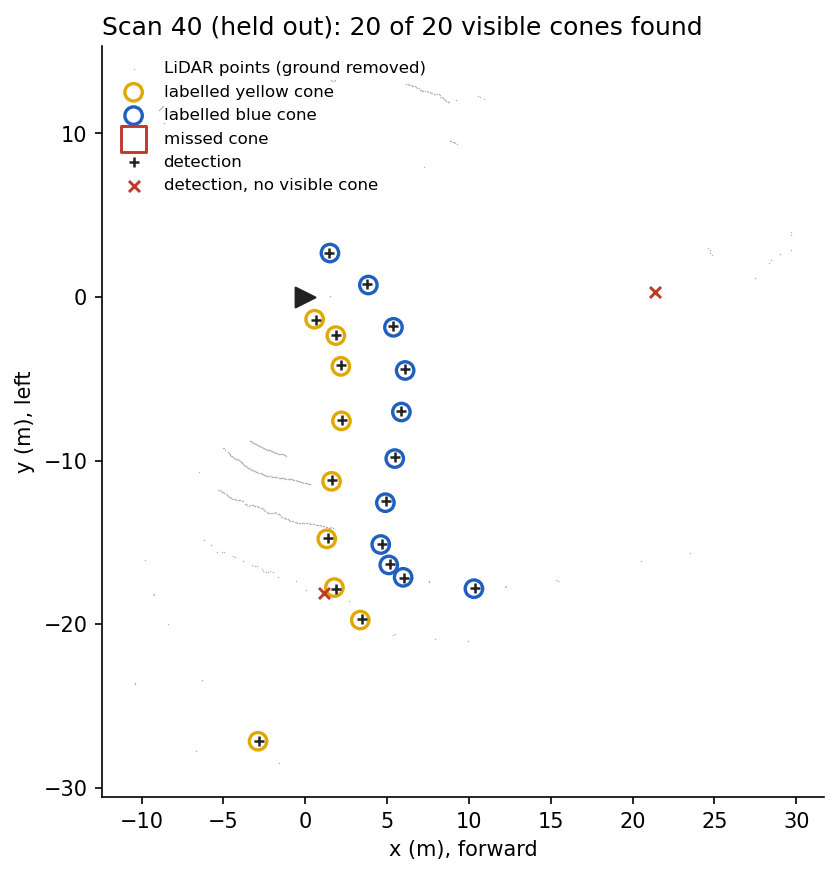

# Cone detection and mapping for Formula Student Driverless

LiDAR pipeline that finds the cones of a Formula Student track in the [coneScenes](https://github.com/Chalmers-Formula-Student/coneScenes) dataset and builds a map of the track from them. Ground removal with RANSAC, DBSCAN clustering, rule-based cone filtering tuned on half of the scans, evaluation against the labelled cones and mapping with the car's odometry.

Work from my time in the driverless team of NOVA Formula Student (2025).



## Results

The scene has 63 labelled scans. Parameters were tuned on the first 31 scans; the scores below are on the remaining 32, which the tuning never saw. A detection counts as correct if it is within 0.5 m of a labelled cone (one-to-one matching). Recall is measured over the cones the LiDAR actually sees, i.e. labelled cones with at least three non-ground points within 0.3 m, up to 30 m.

| | Scans | Precision | Recall | F1 | Mean position error |
|---|---|---|---|---|---|
| Tuning half | 31 | 0.95 | 0.96 | 0.96 | 5.7 cm |
| Held-out half | 32 | 0.95 | 0.96 | 0.96 | 6.8 cm |

By distance from the car (held-out scans):

| Distance | Visible cones | Precision | Recall | Mean position error |
|---|---|---|---|---|
| 0–10 m | 268 | 1.00 | 1.00 | 6.2 cm |
| 10–20 m | 575 | 0.97 | 0.94 | 6.9 cm |
| 20–30 m | 50 | 0.63 | 0.96 | 9.2 cm |



Beyond 20 m a cone returns only a few points, and other small objects next to the track pass the size rules, so precision drops.

**Map.** Detections from all 63 scans, moved to the world frame and merged, give 155 landmarks. All 144 cones of the track are among them, with a mean position error of 3.2 cm; the other 11 landmarks are objects off the track.



## Pipeline

1. `ground.py`: drops the points within 1.5 m of the sensor (returns from the car itself) and beyond 30 m, fits the ground plane with RANSAC and keeps the points 5 to 60 cm above it.
2. `clustering.py`: DBSCAN on (x, y) in metres; per cluster the point count, footprint, height and centroid.
3. `cone_detector.py`: keeps clusters with a footprint of at most 0.6 m, a height between 0.15 and 0.6 m and at least three points.
4. `evaluate.py`: matches detections to visible labelled cones with the Hungarian algorithm and computes precision, recall and position error.
5. `tune.py`: grid search over DBSCAN `eps` and `min_samples` and the cone rules (3,240 combinations), chosen by F1 on the tuning scans. The chosen values are in `results/params.json`.
6. `mapping.py`: moves detections to the world frame and merges detections seen in at least two scans into one landmark.
7. `plots.py`: the figures above.

`main.py` runs everything and writes the tables to `results/` and the figures to `figures/`.

## Data

The scene is `cfs_vargarda8` from coneScenes (Chalmers Formula Student, Vårgårda, 2023), the sample scene linked from the coneScenes repository. It is not included here; download it and place it next to the scripts:

```text
cfs_vargarda8/
├── points/          63 LiDAR scans (.bin, x y z intensity)
├── labels/          cone labels per scan (x y z dx dy dz yaw class)
└── metadata.json    odometry per scan
```

The labels list every cone of the track in the frame of each scan, also the cones the sensor cannot see. The poses in `metadata.json` give the map origin as seen from the car rather than the car's position on the map, so a point `p` in a scan maps to the world as `R(-yaw) (p - (x, y))`. With this convention the labels of all 63 scans land on the same world positions.

## Running

```bash
pip install -r requirements.txt
python main.py    # about two minutes on 18 cores
```

`N_JOBS` sets the number of processes for the grid search, e.g. `N_JOBS=8 python main.py`.

## Limitations

- One scene only. The scans of the tuning and held-out halves come from the same track and session, so the scores say little about other tracks, weather or sensors.
- Cone colour (yellow or blue) is not predicted.
- Visibility is defined from the same point cloud the detector uses; cones hidden behind other cones or outside the field of view are not counted as misses.
- Detection is per scan. Requiring a cone to appear in consecutive scans is the obvious next step against the far-range false positives.
