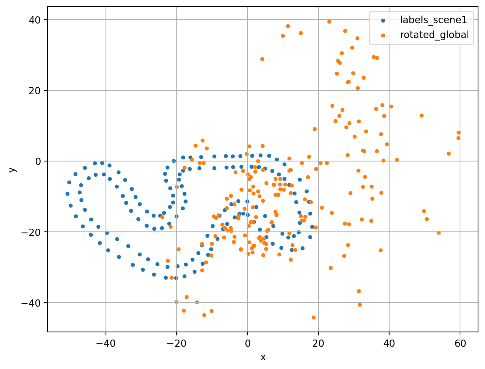

# Cone detection and localisation for Formula Student Driverless

LiDAR pipeline that finds the traffic cones of a Formula Student track in the [coneScenes](https://github.com/Chalmers-Formula-Student/coneScenes) dataset, attaches the car's odometry to each detection, projects the cones into a global frame and re-expresses them relative to the first scene. Clustering with DBSCAN, rule-based cone filtering, coordinate transforms and a comparison against the ground-truth labels.



## Pipeline

1. `clustering.py`: loads each `.bin` point cloud, clusters the points with DBSCAN on (x, y) and summarises every cluster (centroid, extent, point count).
2. `cone_detector.py`: flags cone-like clusters with size and point-count rules. The upper bounds come from the labelled cones (`label_summary.ipynb`), the lower bounds filter noise.
3. `attach_odom.py`: joins the car's pose from `metadata.json` (x, y, z, yaw, velocities, timestamp) to each cluster.
4. `globalize_cones.py`: local to global coordinates.
5. `rotate_to_scene1.py`: global to the local frame of scene 1, so that every scene can be compared with the first one's labels.
6. `plot.py`, `plot_overlay_scene1.py`: global map, scene-1 map and the overlay above.

`main.py` runs the six steps in order. Outputs are the CSVs and PNGs in this repository:

```text
cluster_summary_all.csv         DBSCAN cluster summaries per scene
cluster_summary_with_flags.csv  the same with an is_cone flag
cones_with_odom.csv             clusters with odometry attached
cones_global.csv                cones in global coordinates
cones_rotated_scene1.csv        cones in the scene-1 frame
global_cones.png, scene1_cones.png, overlay_scene1.png
```

## Data

The scene used here is `cfs_vargarda8` from coneScenes (Chalmers Formula Student, Vårgårda 2023). It is not included in the repository; download it with the coneScenes CLI and place it next to the scripts:

```text
cfs_vargarda8/
├── points/          LiDAR .bin files per scene
├── labels/          ground-truth cone labels
└── metadata.json    odometry and scene metadata
```

## Running

```bash
pip install -r requirements.txt
python main.py
```

## Notes and limitations

- DBSCAN runs on (x, y) only; z and intensity are kept in the cluster summaries but do not affect the clustering.
- Initial DBSCAN parameters were adapted from [this reference implementation](https://github.com/sanchezfdezjavier/Self-driving-LiDAR-cone-detection/blob/main/src/lidar_nodes/src/clustering.py).
- Results are sensitive to the DBSCAN parameters (`eps`, `min_samples`) and to the rule thresholds (`dx`, `dy`, `dz`, point count). There is no objective yet that scores a parameter set against the labels, so the values were chosen by inspection.

## Next steps

- A loss that compares detected and labelled cones, so that thresholds and DBSCAN parameters can be tuned instead of hand-picked.
- Learned cone detection instead of size rules.
- Using consecutive frames for temporally stable detections.
- Rebuilding the track from the detected cones and computing a racing line on it.
